<a href="https://github.com/meghnapant-png">
  <picture><source media="(min-width: 701px)" srcset="assets/hero.svg"></picture>
</a>

  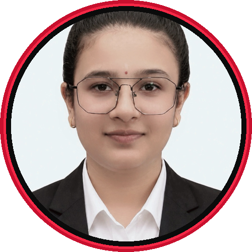

  
  

<picture><source media="(min-width: 701px)" srcset="assets/abyss.svg"></picture>

<picture><source media="(min-width: 701px)" srcset="assets/layer-01.svg">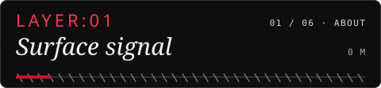</picture>
<picture><source media="(min-width: 701px)" srcset="assets/about.svg">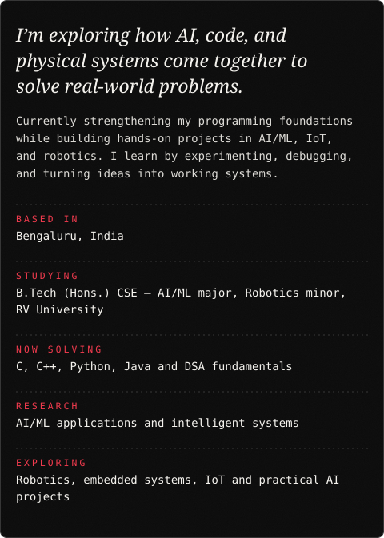</picture>

<picture><source media="(min-width: 701px)" srcset="assets/layer-02.svg">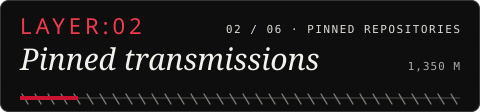</picture>
<!--PINNED:START-->
<!-- The GitHub Action will automatically render repository cards from meghnapant-png. -->
<!--PINNED:END-->

<picture><source media="(min-width: 701px)" srcset="assets/layer-03.svg">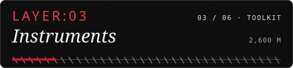</picture>
<picture><source media="(min-width: 701px)" srcset="assets/toolkit.svg">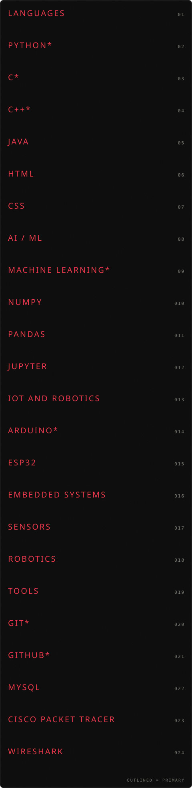</picture>

<picture><source media="(min-width: 701px)" srcset="assets/layer-04.svg">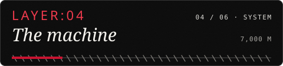</picture>
<picture><source media="(min-width: 701px)" srcset="assets/system.svg">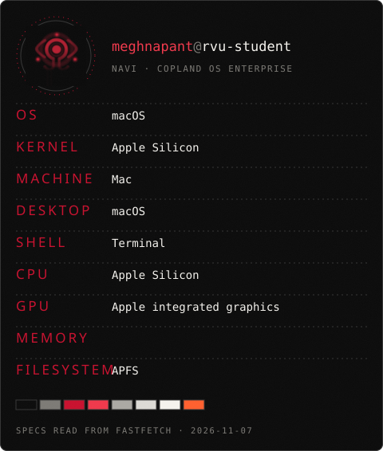</picture>

<picture><source media="(min-width: 701px)" srcset="assets/layer-05.svg">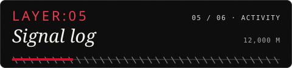</picture>
<picture><source media="(min-width: 701px)" srcset="assets/signal.svg"></picture>

<picture><source media="(min-width: 701px)" srcset="assets/layer-06.svg">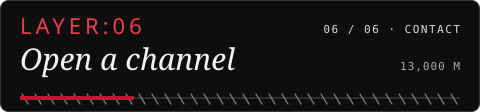</picture>

  

<picture><source media="(min-width: 701px)" srcset="assets/footer.svg"></picture>
