


 


 

  


<table width="100%">
<tr>
<td width="250" valign="top" align="center">
 
</td>
<td valign="top">
</td>
</tr>
</table>

 


  


  


<a href="https://github.com/meghnapant-png/WIFI_MERGER"></a>
<a href="https://github.com/meghnapant-png/FILEVO"></a>

  


  


<!--
Optional: to show your REAL contribution graph instead of the built-in snake,
run the "Generate contribution snake" workflow once (Actions tab), then swap the
snake.svg line above for this block:

<picture>
  <source media="(prefers-color-scheme: dark)" srcset="https://raw.githubusercontent.com/meghnapant-png/meghnapant-png/output/snake-dark.svg"/>
  <source media="(prefers-color-scheme: light)" srcset="https://raw.githubusercontent.com/meghnapant-png/meghnapant-png/output/snake.svg"/>
  
</picture>
-->

  


  


 

&nbsp;

&nbsp;

&nbsp;

  


